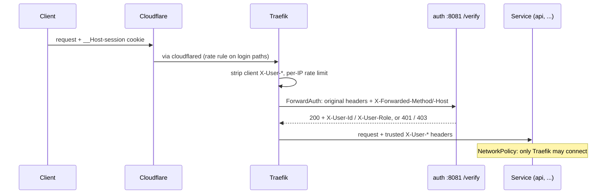

# 13 · M4: ForwardAuth and rate limiting

Goal: Traefik checks the session once at the edge and passes a trusted identity to every service; login and API traffic is rate limited in three layers (Cloudflare, Traefik, auth with Redis). Four PRs.

## PR 1: internal verify endpoint (auth) ✅
1. `GET /verify` on a second, cluster-only listener (`INTERNAL_ADDR`, port `8081`); the public router and the Ingress never serve it.
2. Valid `__Host-session` cookie: `200` with `X-User-Id` and `X-User-Role`, no body. No or expired session: `401 unauthenticated`. Database error: `500`, so access fails closed.
3. `X-User-Role` is the effective role: `admin` only with 2FA on, the same rule as `RequireAdmin`.
4. CSRF for every service: the cross-origin check runs on the forwarded request (`X-Forwarded-Method`/`-Host`), so a cross-site POST to any service gets `403 cross_origin`.
5. `httpserver.RunAll`: both listeners share one lifecycle; if one fails, the pod restarts.
6. Helm chart: optional `internalPort` (container port, `INTERNAL_ADDR`, Service port `internal`); auth sets `8081`.

Done when: in dev, `curl` to `auth:8081/verify` with a session cookie returns 200 and the identity headers, without one 401, and `https://cloud-dev.mohedine.dev/verify` is not routed to auth.

## PR 2: Traefik ForwardAuth and the trust boundary ✅
1. The auth release creates the Traefik Middlewares `forwardauth` (→ `http://auth.mycloud-<env>.svc.cluster.local:8081/verify`, `authResponseHeaders: [X-User-Id, X-User-Role]`) and `strip-identity` (deletes client-sent `X-User-*`).
2. api: second Ingress `api-protected` on `/api` with `strip-identity` then `forwardauth`; `/` stays public. auth's own Ingress uses only `strip-identity`, so login and register work without a session.
3. `backend/internal/identity`: `FromRequest`, `Require` (401 without headers, fails closed), `FromContext`; auth's `/verify` uses the same header names.
4. `GET /api/whoami` in api: echoes the trusted identity, to prove the chain end to end.
5. NetworkPolicies: auth and api accept ingress only from the Traefik pods; the CNPG pods only from auth, api, each other and the CNPG operator; new app `baseline` denies all other ingress.
6. Rollout: middlewares and `whoami` in every environment; NetworkPolicies and `baseline` one environment at a time (dev → qa → prod), now active everywhere.

Done when: in dev `/api/whoami` returns the logged-in user, no cookie gives `401`, a forged `X-User-Role` is ignored, a cross-site POST gives `403`, a pod in another namespace can't reach api, and all pods stay Ready. Then the same NetworkPolicies are switched on for qa and prod.

## PR 3: Redis per environment ✅
1. Own Helm chart `deploy/charts/redis` (official `redis:8.2-alpine`): Deployment (1 replica, `Recreate`), Service, ConfigMap `redis.conf`, ExternalSecret, NetworkPolicy.
2. No persistence (`save ""`, `appendonly no`): rate-limit counters may be lost on restart. `maxmemory 64mb`, `volatile-ttl`.
3. Access control: Vault `secret/mycloud/<env>/redis` (`password`) → ESO renders the ACL file. User `default` is off; user `auth` may only use keys `rl:*` and the commands the limiter needs. Redis only stores the SHA-256 of the password.
4. NetworkPolicy: only auth pods may reach port 6379 (on in every environment from the start).
5. Hardened like the services: non-root (uid 999), read-only root filesystem, no capabilities, no service account token, TCP probes.
6. New ApplicationSet `mycloud-data` (`deploy/data/<name>/<env>` → chart `deploy/charts/<name>`), apps `redis-dev`, `redis-qa`, `redis-prod`; CI lints and validates the data charts.

Done when: `redis-<env>` is Healthy in Argo CD, `PING` as user `auth` returns `PONG`, the default user and forbidden commands are refused, and a pod outside the namespace can't connect.

## PR 4: rate limiting in three layers
1. auth `Limiter` (`ratelimit.go`, `go-redis`): failed logins per account+IP (5 per 15 min), per IP (20 per 15 min) and per account (50 per hour). Checked before argon2id; `429 too_many_attempts` + `Retry-After`; `INCR` + `EXPIRE … NX` in one `MULTI/EXEC`; the account+IP counter is cleared after a complete login.
2. Wrong 2FA codes count on the same keys (`*CodeError` carries the email); the IP limit is checked before the code.
3. Emails only as SHA-256 in Redis; unknown emails are counted like real ones; client IP from `CF-Connecting-IP`, IPv6 grouped by /64.
4. Fail open: Redis unreachable → request allowed, warning logged; fast client (500 ms dial, 300 ms commands, no retries); Redis not in `/readyz`.
5. CLI `unlock --email … [--ip …]` for support cases.
6. Traefik Middleware `ratelimit` (10 req/s, burst 20, per `CF-Connecting-IP`) from the auth release, first in the chain: `/api/*` → `ratelimit, strip-identity, forwardauth`; `/api/auth` → `ratelimit, strip-identity`.
7. auth gets `REDIS_ADDR`, `REDIS_USER` and `REDIS_PASSWORD` (ExternalSecret `auth-redis`, same Vault entry as the Redis ACL).
8. Cloudflare rate-limiting rule on the login and register paths (dashboard, `Troubleshooting/rate_limiting.md`).
9. CI runs the tests with a Redis service container (`TEST_REDIS_ADDR`).

Done when: 5 wrong passwords give `429` with `Retry-After`, the right password stays blocked until the lock expires or `unlock`, a burst from one IP gets Traefik's `429`, login still works with Redis scaled to 0, and normal use is unaffected.

Result: one place decides who is logged in, services can't be reached around it, and brute force is slowed down at every layer.
