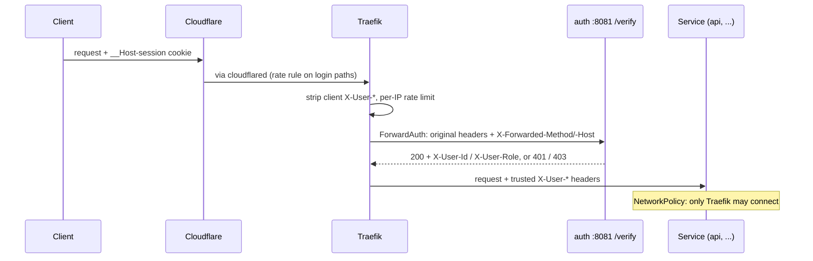

# 13 · M4: ForwardAuth and rate limiting

Goal: Traefik checks the session once at the edge and passes a trusted identity to every service; login and API traffic is rate limited in three layers.

## PR 1: internal verify endpoint (auth)
1. `GET /verify` on a second, cluster-only listener (`INTERNAL_ADDR`, port `8081`); the public router and the Ingress never serve it.
2. Valid `__Host-session` cookie: `200` with `X-User-Id` and `X-User-Role`, no body. No or expired session: `401 unauthenticated`. Database error: `500`, so access fails closed.
3. `X-User-Role` is the effective role: `admin` only with 2FA on, the same rule as `RequireAdmin`.
4. CSRF for every service: the cross-origin check runs on the forwarded request (`X-Forwarded-Method`/`-Host`), so a cross-site POST to any service gets `403 cross_origin`.
5. `httpserver.RunAll`: both listeners share one lifecycle; if one fails, the pod restarts.
6. Helm chart: optional `internalPort` (container port, `INTERNAL_ADDR`, Service port `internal`); auth sets `8081`.

Done when: in dev, `curl` to `auth:8081/verify` with a session cookie returns 200 and the identity headers, without one 401, and `https://cloud-dev.mohedine.dev/verify` is not routed to auth.

## PR 2: Traefik ForwardAuth and the trust boundary
1. Traefik `Middleware` `forwardauth` → `http://auth.mycloud-<env>.svc.cluster.local:8081/verify`, `authResponseHeaders: [X-User-Id, X-User-Role]`.
2. A `headers` middleware that removes client-sent `X-User-*` before ForwardAuth, so nobody can fake an identity.
3. Protected Ingresses (api, later space/upload/file) use both middlewares; public auth routes (login, register) do not.
4. `NetworkPolicy` per namespace: services accept traffic only from Traefik (kube-system) and their own probes; auth's port 8081 only from Traefik.
5. `GET /api/whoami` in api: echoes the trusted headers, to prove the chain end to end.

Done when: `/api/whoami` returns the logged-in user, a forged `X-User-Id` is ignored, and a pod in another namespace can't reach api directly.

## PR 3: rate limiting in three layers
1. Cloudflare rate-limiting rule on `/api/auth/login*` and `/api/auth/register` (blocks floods before they reach the home line).
2. Traefik `RateLimit` middleware on `/api/*`, keyed on `CF-Connecting-IP` (otherwise every request looks like cloudflared).
3. auth: failed-login limit per account and per IP, stored in Postgres; the 5-attempt limit per 2FA challenge stays.
4. Clear `429` responses with `Retry-After`; log lockouts with `slog`, never passwords.

Done when: the 11th request per second from one IP gets 429, the 6th wrong password in 15 minutes locks the account for up to 15 minutes, and normal use is unaffected.

Open decisions: counters in Postgres (now) vs Redis (later); limit values (about 10 req/s per IP, 5 failed logins per 15 min); lock vs delay (lock up to 15 min with a clear message).

Result: one place decides who is logged in, services can't be reached around it, and brute force is slowed down at every layer.
