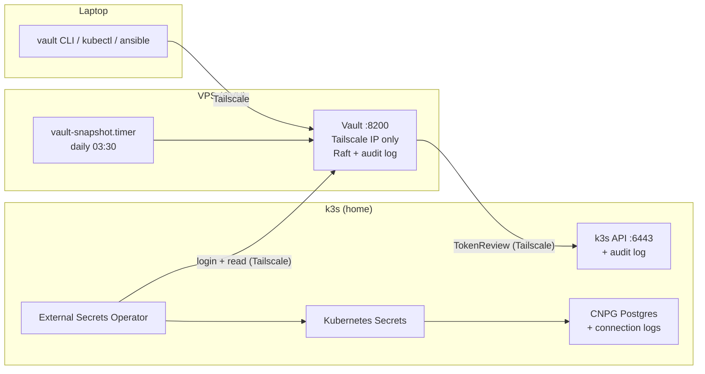

# Secrets & audit: verification commands

How to check that audit logging, Vault on the VPS and External Secrets Operator (ESO) work.
Every check here was run once during setup; re-run them after changes or incidents.

Suggested location in the repo: `infra/README.md`

| Where | Means |
|---|---|
| **laptop** | Your PC, on Tailscale, with `kubectl`, `vault` and `ansible` installed |
| **cp1** | `ssh controlPlane` (k3s control plane) |
| **VPS** | `ssh <vps>` (Ubuntu 24.04, portfolio + Vault) |

> No secret values belong in this file: no tokens, unseal keys or passwords.

---

## Contents

- [Architecture](#architecture)
- [Step 2: audit logging](#step-2-audit-logging)
- [Step 3a: network, DNS and TLS](#step-3a-network-dns-and-tls)
- [Step 3b part 1: Vault server (Ansible)](#step-3b-part-1-vault-server-ansible)
- [Step 3b part 2: Vault configuration (Ansible)](#step-3b-part-2-vault-configuration-ansible)
- [Backups: snapshots and restore test](#backups-snapshots-and-restore-test)
- [Step 4: External Secrets Operator](#step-4-external-secrets-operator)
- [Day-to-day operations](#day-to-day-operations)
- [Troubleshooting](#troubleshooting)

---

## Architecture



| Component | Files in the repo |
|---|---|
| k3s audit policy | `infra/k3s/` |
| Tailscale ACL | `infra/tailscale/policy.hujson` |
| VPS notes | `infra/vps/README.md` |
| Vault install | `infra/ansible/vault.yml`, `roles/vault` |
| Vault configuration | `infra/ansible/vault-configure.yml`, `roles/vault_config`, `roles/vault_snapshot` |
| Snapshot download | `infra/ansible/vault-backup-fetch.yml` |
| ESO + ClusterSecretStore | `deploy/argocd/platform.yaml`, `deploy/platform/secret-store/` |

---

## Step 2: audit logging

### k3s API audit log (cp1)

Config on cp1: `/etc/rancher/k3s/config.yaml.d/10-audit.yaml` and policy `/var/lib/rancher/k3s/server/audit.yaml`.

The log exists and grows (**cp1**):
```bash
sudo ls -lh /var/lib/rancher/k3s/server/logs/
sudo wc -l /var/lib/rancher/k3s/server/logs/audit.log; sleep 60; sudo wc -l /var/lib/rancher/k3s/server/logs/audit.log
```

Your own Secret read is recorded with your Tailscale IP.

**laptop:**
```bash
tailscale ip -4
kubectl -n mycloud-dev get secret auth-db -o name
```
**cp1:**
```bash
sudo jq -c 'select(.objectRef.resource=="secrets" and .objectRef.name=="auth-db" and .user.username=="system:admin")
  | {t: .requestReceivedTimestamp, user: .user.username, verb, ip: .sourceIPs[0], code: .responseStatus.code}' \
  /var/lib/rancher/k3s/server/logs/audit.log | tail -3
```
Expected: `user: system:admin`, `verb: get`, `ip` = your Tailscale IP. Times are UTC.

`kubectl exec` is recorded.

**laptop:**
```bash
kubectl -n mycloud-dev exec deploy/auth -- /app help
```
**cp1:**
```bash
sudo jq -c 'select(.objectRef.subresource=="exec")
  | {t: .requestReceivedTimestamp, user: .user.username, ns: .objectRef.namespace, pod: .objectRef.name, ip: .sourceIPs[0]}' \
  /var/lib/rancher/k3s/server/logs/audit.log | tail -3
```

Noisiest users, to tune the policy (**cp1**):
```bash
sudo jq -r '.user.username' /var/lib/rancher/k3s/server/logs/audit.log | sort | uniq -c | sort -rn | head
```

The admin kubeconfig is private (**cp1**):
```bash
ls -l /etc/rancher/k3s/k3s.yaml        # -rw------- root root
```

### Postgres connection logs (CNPG)

The setting is active (**laptop**):
```bash
kubectl -n mycloud-dev exec db-1 -- psql -U postgres -tc 'show log_connections'     # on
```

A successful and a failed login (**laptop**):
```bash
# password through stdin, never in the exec command line (that line is written to the k3s audit log)
kubectl -n mycloud-dev get secret auth-db -o jsonpath='{.data.password}' | base64 -d \
| kubectl -n mycloud-dev exec -i db-1 -- sh -c 'read -r PGPASSWORD; export PGPASSWORD; psql -h localhost -U auth -d auth -c "select 1"'
kubectl -n mycloud-dev exec db-1 -- psql "host=localhost user=auth dbname=auth password=wrong" -c 'select 1'
```

Read them:
```bash
kubectl -n mycloud-dev logs db-1 -c postgres --since=10m \
  | jq -r 'select(.logger=="postgres") | .record
           | select(.message | test("connection authorized|authentication failed|disconnection"))
           | [.log_time, .user_name, .database_name, .remote_host, .message] | @tsv'
```
Expected: `connection authorized: user=auth database=auth` and `password authentication failed for user "auth"`.

---

## Step 3a: network, DNS and TLS

Tailscale (**laptop**):
```bash
tailscale status          # cp1, worker1 (tag:k3s), vps (tag:vault), your PC
```
The ACL lives in the Tailscale admin console; the copy in Git is `infra/tailscale/policy.hujson`. Its `tests` block must pass on save.

DNS points to the Tailscale IP (**laptop**):
```bash
dig +short vault.mohedine.dev           # 100.x.y.z (Cloudflare record: DNS only)
```

Certificate (**VPS**):
```bash
sudo openssl x509 -in /etc/letsencrypt/live/vault.mohedine.dev/fullchain.pem -noout -subject -issuer -dates
sudo certbot renew --dry-run
systemctl list-timers | grep certbot
ls -l /etc/letsencrypt/renewal-hooks/deploy/vault.sh
```

Pods on **both** nodes reach Vault (**laptop**):
```bash
for n in cp1 worker1; do
  kubectl run nettest-$n --restart=Never --image=curlimages/curl \
    --overrides="{\"spec\":{\"nodeName\":\"$n\"}}" \
    -- sh -c 'curl -s -o /dev/null -w "%{http_code}\n" --max-time 5 https://vault.mohedine.dev:8200/v1/sys/health; exit 0'
done
kubectl wait --for=jsonpath='{.status.phase}'=Succeeded pod/nettest-cp1 pod/nettest-worker1 --timeout=60s
for n in cp1 worker1; do echo "$n: $(kubectl logs nettest-$n)"; done
kubectl delete pod nettest-cp1 nettest-worker1
```
Expected: `200` from both nodes (Vault unsealed).

Negative tests:
```bash
nc -zv -w 3 <VPS_PUBLIC_IP> 8200                         # laptop: refused / timeout
ssh controlPlane "nc -zv -w 3 <VPS_TS_IP> 22"            # ACL: cp1 → VPS:22 blocked
```

Vault → k3s API (**VPS**), needed for TokenReview:
```bash
curl -sk --max-time 5 -o /dev/null -w '%{http_code}\n' https://100.92.246.101:6443/version    # 200 or 401
```

---

## Step 3b part 1: Vault server (Ansible)

Run from `infra/ansible/` on the **laptop**.

SSH and idempotency:
```bash
ansible vault -m ping                      # pong
ansible-playbook vault.yml -K              # 2nd run: changed=0
ansible-playbook vault.yml -K --check --diff   # dry run, shows file changes
```

Server state (**VPS**):
```bash
systemctl status vault --no-pager | head -5
sudo ss -ltnp | grep 8200                  # bound to the Tailscale IP only, not 0.0.0.0
apt-mark showhold | grep vault             # vault (held: no surprise upgrades)
sudo ufw status | grep 8200                # ALLOW IN on tailscale0
sudo ls -ld /opt/vault/data                # drwx------ vault vault
```

Status and health (**laptop**):
```bash
vault status                               # Initialized true, Sealed false, Storage raft
curl -s https://vault.mohedine.dev:8200/v1/sys/health | jq    # valid TLS, no -k
```

Reboot test: Vault must come back **sealed** and start after Tailscale (**laptop**):
```bash
ssh <vps> 'sudo reboot'
# wait ~1 min
vault status                               # Sealed: true
vault operator unseal                      # key 1
vault operator unseal                      # key 2
vault status                               # Sealed: false
curl -sI https://mohedine-belhaj.com | head -1    # portfolio still up
```

---

## Step 3b part 2: Vault configuration (Ansible)

**laptop**, in `infra/ansible/`:
```bash
vault login -method=userpass username=moheddine
ansible-playbook vault-configure.yml -K     # 2nd run: changed=0, no password prompt
```
The two password prompts are:
- `BECOME password` = your VPS sudo password;
- `New Vault password for 'moheddine'` = only asked when the user doesn't exist yet.

What should exist (**laptop**):
```bash
vault token lookup | grep -E 'policies|ttl'      # [admin default], ~8h
vault audit list                                 # file/   file_path=/var/log/vault/audit.log
vault secrets list                               # secret/  kv  (version 2)
vault auth list                                  # kubernetes/  token/  userpass/
vault policy list                                # admin  default  eso  root  snapshot
vault policy read eso                            # read-only on secret/data/mycloud/* and platform/*
vault read auth/kubernetes/config                # kubernetes_host https://100.92.246.101:6443
vault read auth/kubernetes/role/eso              # SA external-secrets/external-secrets, policies [eso], ttl 1h,
                                                 # audience https://kubernetes.default.svc.cluster.local
```

The root token is revoked. There's no root token to test with. `vault token lookup` must never show `root` in daily use. A new one can only be made with `vault operator generate-root` and 2 unseal keys.

Audit log records reads, without values.

**laptop:**
```bash
vault kv put secret/mycloud/dev/hello message=world
vault kv get secret/mycloud/dev/hello
```
**VPS:**
```bash
sudo tail -n 3 /var/log/vault/audit.log \
  | jq -c '{time, type, path: .request.path, user: .auth.display_name, policies: .auth.policies}'
```
Expected: `path: secret/data/mycloud/dev/hello`, `user: userpass-moheddine`. The value `world` never appears in the log.

---

## Backups: snapshots and restore test

Timer and token (**VPS**):
```bash
systemctl list-timers vault-snapshot.timer
sudo systemctl start vault-snapshot.service
sudo journalctl -u vault-snapshot -n 5 --no-pager      # "snapshot saved: … (… bytes)"
sudo ls -l /var/backups/vault/
sudo sh -c 'VAULT_TOKEN=$(cat /etc/vault.d/snapshot.token) vault token lookup' \
  | grep -E 'policies|period|ttl|orphan'               # [default snapshot], period 168h, orphan true
```

Copy the newest snapshot to the laptop. Do this weekly (**laptop**, in `infra/ansible/`):
```bash
ansible-playbook vault-backup-fetch.yml -K
ls -lh ~/backups/vault/
```

**Restore test** (**laptop**, Docker). It proves that snapshot, unseal keys and admin login restore your data. Use a dedicated terminal and close it afterwards:
```bash
mkdir -p ~/vault-restore-test && cd ~/vault-restore-test
cp "$(ls -t ~/backups/vault/vault-*.snap | head -1)" test.snap

docker run -d --name vault-restore --cap-add IPC_LOCK -p 127.0.0.1:18200:8200 \
  -e 'VAULT_LOCAL_CONFIG={"storage":{"raft":{"path":"/vault/file","node_id":"restore"}},"listener":[{"tcp":{"address":"0.0.0.0:8200","tls_disable":true}}],"api_addr":"http://127.0.0.1:8200","cluster_addr":"http://127.0.0.1:8201","disable_mlock":true}' \
  hashicorp/vault:latest server

export VAULT_ADDR=http://127.0.0.1:18200
vault operator init -key-shares=1 -key-threshold=1     # throwaway key + root token
vault operator unseal                                  # throwaway key
export VAULT_TOKEN=<throwaway root token>
vault operator raft snapshot restore -force test.snap
unset VAULT_TOKEN

vault status                     # Sealed: true → needs the REAL keys now
vault operator unseal            # real key 1
vault operator unseal            # real key 2
VAULT_TOKEN=$(vault login -no-store -field=token -method=userpass username=moheddine) \
  vault kv get secret/mycloud/dev/hello                # message = world

docker rm -f vault-restore && rm -f test.snap
exit
```

---

## Step 4: External Secrets Operator

Argo CD and pods (**laptop**):
```bash
kubectl -n argocd get app external-secrets secret-store      # Synced / Healthy
kubectl -n external-secrets get pods                         # controller, webhook, cert-controller Running
kubectl get crd | grep external-secrets.io
kubectl get clusterrolebinding external-secrets-vault-tokenreview
```

The store is valid:
```bash
kubectl get clustersecretstore vault                         # STATUS Valid, READY True
```

A test secret syncs (temporary, not committed):
```bash
kubectl apply -f - <<'EOF'
apiVersion: external-secrets.io/v1
kind: ExternalSecret
metadata:
  name: vault-hello
  namespace: mycloud-dev
spec:
  refreshInterval: 1h
  secretStoreRef:
    kind: ClusterSecretStore
    name: vault
  target:
    name: vault-hello
  data:
    - secretKey: message
      remoteRef:
        key: mycloud/dev/hello
        property: message
EOF
kubectl -n mycloud-dev get externalsecret vault-hello        # SecretSynced, READY True
kubectl -n mycloud-dev get secret vault-hello -o jsonpath='{.data.message}' | base64 -d; echo   # world
```

Other namespaces are refused:
```bash
kubectl apply -f - <<'EOF'
apiVersion: external-secrets.io/v1
kind: ExternalSecret
metadata: { name: vault-hello, namespace: default }
spec:
  secretStoreRef: { kind: ClusterSecretStore, name: vault }
  target: { name: vault-hello }
  data:
    - secretKey: message
      remoteRef: { key: mycloud/dev/hello, property: message }
EOF
kubectl -n default describe externalsecret vault-hello | grep -i -A2 'not allowed\|error'
```

The Vault audit log shows ESO's login and read (**VPS**):
```bash
sudo grep -E 'auth/kubernetes/login|secret/data/mycloud/dev/hello' /var/log/vault/audit.log | tail -4 \
  | jq -c '{time, type, path: .request.path, who: .auth.display_name, policies: .auth.policies, role: .auth.metadata.role}'
```
Expected: login with `role: eso`, reads by `kubernetes-external-secrets-external-secrets` with `[default eso]`.

The k3s audit log shows Vault's TokenReview (**cp1**):
```bash
sudo jq -c 'select(.objectRef.resource=="tokenreviews")
  | {t: .requestReceivedTimestamp, user: .user.username, ip: .sourceIPs[0], code: .responseStatus.code}' \
  /var/lib/rancher/k3s/server/logs/audit.log | tail -3
```
Expected: `user: system:serviceaccount:external-secrets:external-secrets` from the VPS's Tailscale IP, `code: 201`.

Clean up:
```bash
kubectl -n mycloud-dev delete externalsecret vault-hello
kubectl -n default delete externalsecret vault-hello
```

---

## Day-to-day operations

| Task | Command |
|---|---|
| Log in | `vault login -method=userpass username=moheddine` |
| Unseal after a VPS reboot | `vault operator unseal` ×2 (2 of 3 keys) |
| Write a secret | `vault kv put secret/mycloud/<env>/<name> key=value` (use `key=-` to read from stdin) |
| Read / history / roll back | `vault kv get`, `vault kv metadata get`, `vault kv rollback -version=N` |
| Who read what | `sudo jq -c '{time, path: .request.path, who: .auth.display_name}' /var/log/vault/audit.log \| tail` (VPS) |
| Re-apply the server role | `ansible-playbook vault.yml -K` (a config change restarts Vault → unseal) |
| Re-apply the configuration | `ansible-playbook vault-configure.yml -K` |
| Fetch the latest backup | `ansible-playbook vault-backup-fetch.yml -K` |
| Upgrade Vault | `sudo apt-mark unhold vault && sudo apt-get install vault && sudo apt-mark hold vault`, then unseal |
| Force an ExternalSecret refresh | `kubectl -n <ns> annotate externalsecret <name> force-sync=$(date +%s) --overwrite` |

---

## Troubleshooting

| Symptom | Cause / fix |
|---|---|
| `vault status` → `Sealed: true` | Vault restarted (reboot, config change, upgrade). Unseal with 2 keys. Running apps are not affected |
| `vault login -method=userpass` → `403 permission denied` | User lockout after 5 failed logins (15 min). As admin: `vault read sys/locked-users`, then `vault write -f sys/locked-users/<accessor>/unlock/moheddine` |
| Playbook: `Conflicting values set for option Signed-By` | A HashiCorp apt repo added by hand. The role removes `/etc/apt/sources.list.d/hashicorp.list`; that task must run before any apt task |
| `ssh … 'sudo …' > file` → `a terminal is required` | sudo needs a password and has no TTY. Use `vault-backup-fetch.yml` (Ansible handles `-K`); never `ssh -t` for binary output |
| `sudo ssh vps …` → `Permission denied (publickey)` | `sudo` ran SSH as root on the laptop. Drop the leading `sudo` |
| Snapshot job: `permission denied` | Snapshot token expired (not renewed for 7 days). Delete `/etc/vault.d/snapshot.token` on the VPS and re-run `vault-configure.yml` |
| Vault returns errors, audit log full | Vault refuses requests it can't audit. Check `df -h /var/log` and logrotate on the VPS |
| ClusterSecretStore not `Valid`: `permission denied` on login | Audience mismatch. Role `eso` and the store's `audiences` must both be `https://kubernetes.default.svc.cluster.local` |
| ClusterSecretStore: `service account name not authorized` | Role bound to another SA. Check `kubectl -n external-secrets get sa` |
| ClusterSecretStore: `x509` / TLS error | Certificate expired or not reloaded: `sudo certbot renew` and check the deploy hook |
| ClusterSecretStore: `context deadline exceeded` | Pod → VPS:8200 blocked. Re-run the pod nettest (step 3a) |
| `secret-store` app `SyncFailed` | ESO CRDs/webhook not ready yet. It retries; check `kubectl -n argocd get app external-secrets` |
| A password shows up in the k3s audit log | It was in a `kubectl exec` command line (the URL is logged). Pass secrets through stdin (`exec -i … sh -c 'read -r X'`) and rotate that password |
| k3s won't start after changing the audit config | `sudo journalctl -u k3s -n 50`; remove `/etc/rancher/k3s/config.yaml.d/10-audit.yaml` and restart to roll back |